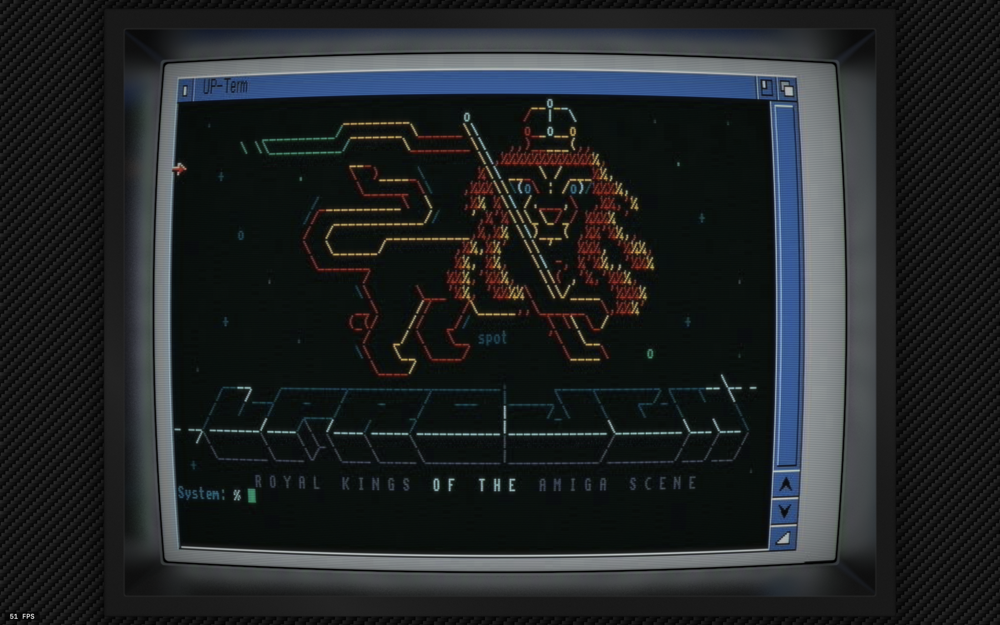

Amiga-View 0.1.0 is the first release: a native macOS app that shows the live picture and sound of a real Amiga A1200, captured by a Raspberry Pi 4 with an STK1160 grabber, so you can test on the Amiga without walking to it.

What it does:

- Live picture over an SSH tunnel to the Pi's camserver, with reconnect and a status line (frame rate, No signal, tunnel errors).
- Sound from the grabber's audio input.
- CRT shader: Mega Bezel presets through librashader on Metal, from Potato to Smooth Advanced Glass, or Off. The view stays black while a preset compiles.
- Full screen with the bezel filling the screen (Control-Command-F or Command-Return; Esc leaves it).
- Actual Size, Double Size, Always on Top, Crop Overscan and Integer Scaling.
- Switch Synergy on Click: a click in the window gives the Amiga keyboard and mouse through Deskflow.
- Save Snapshot (Command-S) and recording.
- Reset Amiga through wasabid on the A1200.

Install: unzip Amiga-View-0.1.0.zip and move Amiga-View.app to Applications. The app is signed with a self-made certificate, not notarised, so the first launch needs right-click > Open. The Pi side (patched stk1160 module, camserver, systemd unit) is set up as the README describes.

Licences: the app is MIT. pi/stk1160 is GPL-2.0. The bundled librashader is MPL-2.0, and the Mega Bezel and slang-shaders presets are GPL-3.0; their licence texts ship in the app.
